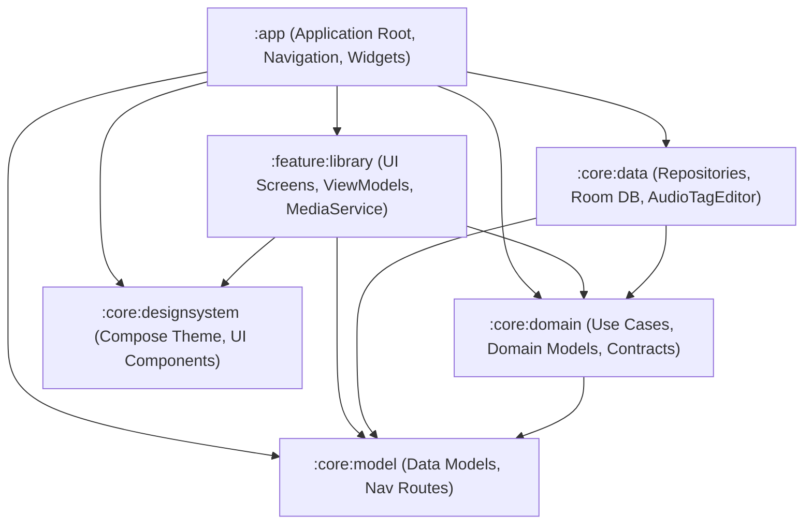

# 🎵 Clean Development Music Player

[](https://developer.android.com/)
[-blue?style=for-the-badge&logo=android)](https://developer.android.com/about/versions/nougat)
[](https://developer.android.com/)
[](https://kotlinlang.org/)
[-4285F4?style=for-the-badge&logo=jetpackcompose&logoColor=white)](https://developer.android.com/jetpack/compose)
[](https://developer.android.com/topic/architecture)
[](https://developer.android.com/guide/topics/media/media3)
[](LICENSE)

A production-grade, modern Android music application engineered with **Jetpack Compose**, **Clean Architecture**, **Hilt**, **Room**, **Jetpack Media3 (ExoPlayer & MediaSessionService)**, and **Jetpack Glance Desktop Widgets**. Featuring a glassmorphic user interface, real-time audio visualization, custom 10-band equalizer, ID3 tag editor, synchronized LRC lyrics, offline/online lyric search, voice-controlled Drive Mode, and multi-language localization.

---

## 📋 Table of Contents

- [✨ Complete Feature Inventory](#-complete-feature-inventory)
  - [🎶 Library Browsing \& Media Management](#-library-browsing--media-management)
  - [▶️ Media3 Playback Engine \& Mini Player](#️-media3-playback-engine--mini-player)
  - [🎤 Lyrics Engine (.LRC \& Online Synced Lyrics)](#-lyrics-engine-lrc--online-synced-lyrics)
  - [🎛️ Audio Processing, Equalizer \& Visualizer](#️-audio-processing-equalizer--visualizer)
  - [🏷️ Audio ID3 Tag Editor](#️-audio-id3-tag-editor)
  - [⏱️ Sleep Timer \& Background WorkManager](#️-sleep-timer--background-workmanager)
  - [🚗 Drive Mode \& Voice Commands](#-drive-mode--voice-commands)
  - [🧩 Jetpack Glance Desktop Widgets](#-jetpack-glance-desktop-widgets)
  - [🚀 App Shortcuts \& Quick Actions](#-app-shortcuts--quick-actions)
  - [💾 Favorites, Playlists \& Backup / Restore](#-favorites-playlists--backup--restore)
  - [🌐 Localization \& Multi-Language Support](#-localization--multi-language-support)
  - [🎨 Dynamic Glassmorphism Theme Engine](#-dynamic-glassmorphism-theme-engine)
  - [💰 Monetization \& Multi-Store Deep Links](#-monetization--multi-store-deep-links)
  - [🔐 Permissions \& Scoped Storage Persistence](#-permissions--scoped-storage-persistence)
- [🏛️ Architecture \& Module Structure](#️-architecture--module-structure)
  - [Module Responsibilities](#module-responsibilities)
  - [Directory Tree](#directory-tree)
- [🛠️ Tech Stack \& Key Dependencies](#️-tech-stack--key-dependencies)
- [🚀 Setup, Build \& Run](#-setup-build--run)
  - [Prerequisites](#prerequisites)
  - [Cloning \& Building](#cloning--building)
  - [Useful Gradle Commands](#useful-gradle-commands)
- [🔧 Troubleshooting](#-troubleshooting)
- [🤝 Contributing](#-contributing)
- [📄 License](#-license)

---

## ✨ Complete Feature Inventory

### 🎶 Library Browsing & Media Management
* **Multi-Tab Category Browsing**: Organize and explore local media collections by **Songs (Tracks)**, **Albums**, **Artists**, **Folders**, **Genres**, and **Playlists**.
* **Indexed Fast-Scrolling Bar**: Custom `AlphabetIndexerBar` component enabling quick alpha-numeric jump and smooth scrolling through extensive song libraries.
* **Media Store Scanner**: Automatic and on-demand media scanning (`MediaScanRepositoryImpl`) that queries Android `MediaStore` audio URIs, filtering out short system audio, voice notes, and corrupted tracks.
* **Folder Hierarchy Navigation**: Browse files by exact device directory structure (`FolderDetailScreen`), giving users direct access to offline audio stored in internal storage or SD cards.

### ▶️ Media3 Playback Engine & Mini Player
* **Jetpack Media3 ExoPlayer & MediaSessionService**: Built on `androidx.media3:media3-exoplayer` and `media3-session`, providing a background audio service (`MusicPlaybackService`) compatible with system media notifications, lock screens, Bluetooth AVRCP controls, and Android Auto interfaces.
* **Crossfade Audio Transitions**: Custom `CrossfadeForwardingPlayer` delivering customizable crossfade durations between audio tracks for smooth, gapless playback transitions.
* **Bottom Mini Player Bar**: Persistent, glassmorphic mini-player anchored at the bottom of the screen (`BottomPlayerBar`) displaying current track title, artist, play/pause controls, progress bar, and swipe/tap gestures to expand the full-screen player.
* **Comprehensive Player Controls**: Full-screen player (`PlayerScreen`) equipped with play/pause, next/previous track, seek bar with elapsed/remaining timestamps, shuffle mode, repeat modes (All, One, Off), and favorite toggle.

### 🎤 Lyrics Engine (.LRC & Online Synced Lyrics)
* **Synchronized LRC Lyrics Rendering**: Real-time line-by-line scrolling lyrics view (`SynchronizedLyricView`) auto-scrolling with current playback timestamp.
* **Embedded & Local .lrc Parser**: `LrcParser` parses synchronized timestamps (`[mm:ss.xx]`) from embedded ID3 lyric tags or sidecar `.lrc` files located in the audio file directory.
* **Online Lyrics Search & Auto-Fetcher**: `OnlineLyricFetcher` searches and retrieves synchronized and plain-text lyrics from remote lyric APIs (`OnlineLyricSearchDialog`).
* **Manual Lyrics Editor**: Built-in lyric creation and manual time-tag editing interface (`ManualLyricEditDialog` & `LyricManagementScreen`) allowing users to adjust line timings or input custom lyrics.

### 🎛️ Audio Processing, Equalizer & Visualizer
* **Custom 10-Band Graphic Equalizer**: `EqualizerAudioFxManager` wraps native Android `Equalizer` audio effects to offer gain band adjustments across multiple frequency ranges alongside system and custom presets (Rock, Pop, Jazz, Classical, Flat, Bass Booster, etc.).
* **Sound Effects & AudioFX**: `SoundEffectAudioFxManager` integrates **Bass Boost**, **Virtualizer (3D Surround Sound)**, **Preset Reverb**, and **Loudness Enhancer / Volume Boost**.
* **FFT Real-Time Audio Visualizer**: `AudioVisualizerManager` extracts frequency spectrums via `Visualizer` API (`RECORD_AUDIO` permission) to power animated circular waveform visualizers.

### 🏷️ Audio ID3 Tag Editor
* **In-App ID3 Tag Editing**: Embedded `AudioTagEditor` utility wrapping `net.jthink:jaudiotagger` library (`EditTagScreen`).
* **Editable Metadata Fields**: Edit Track Title, Artist, Album, Genre, Track Number, Year, and Comment directly on MP3, FLAC, M4A, and AAC files without needing a desktop editor.

### ⏱️ Sleep Timer & Background WorkManager
* **Flexible Sleep Timer**: Schedule automatic playback pause after a set duration (Presets: 5 min, 10 min, 15 min, 30 min, 45 min, 60 min, or custom time picker `CustomTimePickerDialog`).
* **"Finish Song Before Stop" Option**: Option to let the currently playing track complete before pausing audio playback.
* **WorkManager Integration**: Uses `SleepTimerWorker` to guarantee accurate countdown timing even when the device enters Doze mode.

### 🚗 Drive Mode & Voice Commands
* **Distraction-Free Drive Screen**: High-contrast, large-button UI interface (`DriveModeScreen`) tailored for automotive or on-the-go usage.
* **Hands-Free Voice Command Matching**: `CommandMatcher` evaluates speech-to-text inputs for voice commands like *"play"*, *"pause"*, *"next"*, *"previous"*, *"shuffle"*, *"favorite"*, or *"search"*.

### 🧩 Jetpack Glance Desktop Widgets
* **`GlassmorphismPlayerWidget`**: Interactive home screen Glance widget featuring a frosted glass background, dynamic album artwork thumbnail, track metadata, progress indicator, and playback control buttons (Play/Pause, Skip Next, Skip Previous, Shuffle, Like).
* **`LyricTickerWidget`**: Home screen widget presenting a real-time scrolling lyric ticker alongside playback control buttons.
* **`WidgetStateUpdater` & DataStore**: Updates Glance widget states across process restarts using Jetpack `DataStore` preferences and state notifications.

### 🚀 App Shortcuts & Quick Actions
* **Android Launcher Shortcuts**: Native application launcher shortcuts (`shortcuts.xml`):
  * ⏯️ **Resume Playback**: Instantly resumes last playing song.
  * 🔀 **Shuffle All**: Starts random playback of the entire song library.
  * ❤️ **Favorites**: Directly opens the Favorites library screen.
  * 🔍 **Search**: Launches the instant media search view.

### 💾 Favorites, Playlists & Backup / Restore
* **Custom Playlist Management**: Create, rename, reorder, and delete custom user playlists (`PlaylistsViewModel`).
* **Favorites System**: Quick one-tap heart toggle to save tracks, albums, artists, or genres to Favorites.
* **JSON Playlist Backup & Restore**: Export custom playlists and track mappings to JSON backup files (`PlaylistBackupRestoreDialog`) and import them on new devices.

### 🌐 Localization & Multi-Language Support
* **Multi-Language Support**: Fully translated into 4 languages (`AppLanguage`):
  * 🇬🇧 **English** (`en`)
  * 🇮🇷 **Persian / Farsi** (`fa` - with native RTL layout support)
  * 🇩🇪 **German** (`de`)
  * 🇹🇷 **Turkish** (`tr`)
* **Dynamic Language Switcher**: Runtime locale configuration helper (`LocaleHelper`) allowing instant language changing within app settings.

### 🎨 Dynamic Glassmorphism Theme Engine
* **Glassmorphic UI Design**: Modern visual layout using semi-transparent frosted cards (`GlassCard`), blur gradients, and sleek navigation drawer transitions (`SlantedNavigationDrawer`).
* **Dynamic Color Accent Palettes**: Multi-color accent themes (`ColorPalette` & `ThemePickerScreen`) allowing custom app accent colors.
* **Dark / Light Theme Modes**: Full Material 3 dark and light theme palette definitions (`Theme.kt`, `Color.kt`).

### 💰 Monetization & Multi-Store Deep Links
* **Tapsell SDK Ad Mediation**: Integrates `ir.tapsell:tapsell` for managing Banner Ads (`BannerAdView`), Native Card Ads (`NativeAdCard`), and Rewarded Video Ads (`RewardedAdHelper`).
* **App Store Deep Linking**: Handlers for launching app review and store pages across **Google Play Store**, **Cafe Bazaar**, and **Myket** (`GooglePlayStoreHandler`, `BazaarStoreHandler`, `MyketStoreHandler`).

### 🔐 Permissions & Scoped Storage Persistence
* **Granular Android Permissions Handler**: Handles Android runtime permissions (`PermissionManager`):
  * Android 13+ (API 33+): `READ_MEDIA_AUDIO`, `POST_NOTIFICATIONS`.
  * Legacy Android (API < 33): `READ_EXTERNAL_STORAGE`, `WRITE_EXTERNAL_STORAGE`.
  * Audio Effects: `RECORD_AUDIO` (for real-time FFT visualizer capture).
* **Room Database Caching**: Local Room database (`MusicDatabase`) with specialized DAOs (`SongDao`, `PlaylistDao`, `LyricDao`) for persisting user data, playlist references, synced lyrics, and playback states.

---

## 🏛️ Architecture & Module Structure

The project strictly follows **Clean Architecture** combined with **MVVM / MVI** patterns and multi-module decoupling:



### Module Responsibilities

| Module | Type | Description |
| :--- | :--- | :--- |
| **`:app`** | Android Application | Top-level entry point containing `MainActivity`, `MusicPlayerApplication`, Hilt dependency injection setup, Jetpack Glance Widgets (`GlassmorphismPlayerWidget`, `LyricTickerWidget`), and App Launcher Shortcuts. |
| **`:feature:library`** | Android Library | Presentation layer containing Jetpack Compose UI screens, ViewModels, Navigation Graphs, `MusicPlaybackService`, `PlayerManager`, Audio FX managers, and Tapsell ad integrations. |
| **`:core:domain`** | Android Library | Pure Kotlin domain layer containing Business Logic, Domain Models (`Song`, `Album`, `Artist`, `Playlist`, `EqualizerState`, `AppSettings`), Repository Interfaces, and 50+ Domain Use Cases. |
| **`:core:data`** | Android Library | Data layer providing Room Database implementation (`MusicDatabase`), DAOs, DataStore Preferences, Repository Implementations, `AudioTagEditor`, `LrcParser`, `OnlineLyricFetcher`, and Media Store Scanner. |
| **`:core:model`** | Android Library | Common data models, serialization models, and type-safe Navigation routes (`Screen.kt`). |
| **`:core:designsystem`** | Android Library | Reusable Material 3 theme definitions, Glassmorphism components (`GlassCard`, `SlantedNavigationDrawer`), Color Palettes, and custom UI components. |

### Directory Tree

```
music_player/
├── app/                                  # Application module
│   ├── build.gradle.kts
│   └── src/main/
│       ├── AndroidManifest.xml
│       ├── java/com/sftwr/cleandevelopment/musicplayer/music_player/
│       │   ├── MusicPlayerApplication.kt
│       │   ├── MainActivity.kt
│       │   ├── di/                       # DatabaseModule, Hilt modules
│       │   ├── navigation/               # AppRootContent, NavGraph, MainViewModel
│       │   ├── ui/theme/                 # App color, theme & typography
│       │   └── widget/                   # Glance player & lyric widgets
│       └── res/                          # Drawables, layouts, shortcuts.xml, locales_config
│
├── core/
│   ├── data/                             # Data Layer
│   │   └── src/main/java/.../data/
│   │       ├── ad/                       # Ad managers (Tapsell)
│   │       ├── launcher/                 # Google Play, Bazaar, Myket handlers
│   │       ├── model/                    # Entities & query result models
│   │       ├── repository/               # Repository implementations
│   │       ├── source/local/             # Room DB, SongDao, PlaylistDao, LyricDao
│   │       ├── source/remote/            # OnlineLyricFetcher
│   │       ├── util/                     # AudioTagEditor, LrcParser, LocaleHelper
│   │       └── worker/                   # SleepTimerWorker
│   │
│   ├── designsystem/                     # Design System & UI Components
│   │   └── src/main/java/.../designsystem/
│   │       └── component/                # GlassCard, AlphabetIndexerBar, BottomPlayerBar...
│   │
│   ├── domain/                           # Domain Layer
│   │   └── src/main/java/.../domain/
│   │       ├── model/                    # Domain models (Song, Album, Artist...)
│   │       ├── repository/               # Repository interfaces
│   │       └── usecase/                  # 50+ clean architecture use cases
│   │
│   └── model/                            # Data Models & Navigation Routes
│       └── src/main/java/.../model/
│           └── Screen.kt                 # Type-safe Kotlin Serialization routes
│
├── feature/
│   └── library/                          # Feature Library (UI & Audio Service)
│       └── src/main/java/.../library/
│           ├── core/                     # MusicPlaybackService, CrossfadeForwardingPlayer, AudioFX
│           ├── di/                       # MediaModule, RepositoryModule, AppStoreModule
│           └── presentation/             # Compose UI screens & ViewModels
│               ├── albums/               # Albums & AlbumDetail
│               ├── artists/              # Artists & ArtistDetail
│               ├── drive_mode/           # DriveMode & CommandMatcher
│               ├── edit/                 # EditTagScreen & EditTagViewModel
│               ├── equalizer/            # EqualizerBottomSheet & ViewModel
│               ├── favorites/            # FavoritesScreen
│               ├── folders/              # Folders & FolderDetail
│               ├── genres/               # Genres & GenreDetail
│               ├── home/                 # HomeScreen & Playlists
│               ├── lyrics/               # Synchronized Lyric Views & Search
│               ├── player/               # Fullscreen PlayerScreen & ViewModel
│               ├── search/               # Neon SearchBar & SearchScreen
│               ├── settings/             # Settings, ThemePicker & Backup/Restore
│               ├── sleeptimer/           # SleepTimerDialog
│               └── soundeffect/          # SoundEffectScreen (BassBoost, Reverb)
│
├── build.gradle.kts                      # Root build configuration
├── settings.gradle.kts                   # Subproject inclusions
└── gradle/libs.versions.toml             # Version Catalog
```

---

## 🛠️ Tech Stack & Key Dependencies

| Technology / Library | Version | Usage / Function |
| :--- | :--- | :--- |
| **Kotlin** | `2.0.0` | Primary language with Kotlin Compose Compiler Plugin |
| **Android Gradle Plugin (AGP)** | `9.4.1` | Build system |
| **Target SDK / Min SDK** | `37` / `24` | Android platform SDK target and minimum compatibility |
| **Jetpack Compose BOM** | `2024.09.00` | Declarative UI framework |
| **Material 3** | `1.12.0` / Compose | Modern UI components and dynamic styling |
| **Hilt** | `2.60.1` | Compile-time Dependency Injection framework |
| **Jetpack Media3 ExoPlayer** | `1.4.1` | Core audio playback engine and `MediaSessionService` |
| **Room Database** | `2.8.5` | SQLite ORM for local caching of songs, playlists, and lyrics |
| **Jetpack Glance** | `1.1.1` | App widgets built with Compose syntax |
| **Jetpack Navigation Compose** | `2.8.7` | Type-safe Kotlin Serialization navigation graph |
| **Kotlinx Coroutines & Flow** | `1.8.1` | Asynchronous programming and reactive data streams |
| **JAudioTagger** | `3.0.1` | Reading and editing ID3 metadata tags on audio files |
| **Coil Compose** | `2.7.0` | Asynchronous image loading for album covers and thumbnails |
| **DataStore Preferences** | `1.1.1` | Key-value persistent storage for settings and widget state |
| **WorkManager** | `2.9.1` | Background worker execution (Sleep Timer) |
| **Tapsell SDK** | `1.4.0-alpha04` | Ad mediation platform |

---

## 🚀 Setup, Build & Run

### Prerequisites
* **Android Studio**: Ladybug / Koala / 2024.2+ or higher.
* **JDK**: Java Development Kit (JDK) 17.
* **Android SDK**: SDK Platform API Level 37 installed via SDK Manager.
* **Device / Emulator**: Physical Android device or Emulator running Android 7.0 (API Level 24) or higher.

### Cloning & Building

1. **Clone the repository**:
   ```bash
   git clone https://github.com/your-username/music_player.git
   cd music_player
   ```

2. **Open in Android Studio**:
   * Launch Android Studio and select **Open**.
   * Select the root `music_player` folder.
   * Allow Gradle to sync dependencies automatically.

3. **Build the Debug APK**:
   ```bash
   ./gradlew assembleDebug
   ```

4. **Install and Run on Connected Device**:
   ```bash
   ./gradlew installDebug
   ```

### Useful Gradle Commands

* **Run Unit Tests**:
  ```bash
  ./gradlew test
  ```
* **Run Android Instrumentation Tests**:
  ```bash
  ./gradlew connectedAndroidTest
  ```
* **Clean Build Artifacts**:
  ```bash
  ./gradlew clean
  ```

---

## 🔧 Troubleshooting

### 1. No Songs Displayed in Library
* **Cause**: Audio permission not granted or Media Store scan pending.
* **Fix**: Ensure `READ_MEDIA_AUDIO` (Android 13+) or `READ_EXTERNAL_STORAGE` (Android <13) permission is granted. Open app Settings and trigger **Rescan Media Library**.

### 2. Equalizer or Sound Effects Not Applying
* **Cause**: Custom vendor ROMs (MIUI, OneUI, ColorOS) sometimes override global system audio session effects.
* **Fix**: Ensure playback is active before launching the Equalizer bottom sheet so the `audioSessionId` binds correctly to `EqualizerAudioFxManager`.

### 3. Desktop Widgets Not Updating
* **Cause**: Device battery optimization killing background updates or DataStore sync delay.
* **Fix**: Disable battery optimization for Music Player in Android system settings. Long-press the Glance widget to resize or re-add it if needed.

### 4. ID3 Tag Editor File Permission Error
* **Cause**: Android Scoped Storage restriction on modifying system files.
* **Fix**: Grant storage modification access when prompted by the system SAF picker during tag saving.

---

## 🤝 Contributing

Contributions are welcome! Please follow these guidelines:

1. **Fork the Repository** and create a feature branch:
   ```bash
   git checkout -b feature/amazing-feature
   ```
2. **Follow Kotlin & Jetpack Compose Best Practices**:
   * Maintain Clean Architecture layering (do not leak data sources into UI models).
   * Ensure new ViewModels expose state via `StateFlow` / `UiState`.
3. **Commit your changes**:
   ```bash
   git commit -m "feat: add amazing audio feature"
   ```
4. **Push to the branch**:
   ```bash
   git push origin feature/amazing-feature
   ```
5. **Open a Pull Request** describing your additions or fixes.

---

## 📄 License

This project is licensed under the **MIT License**. See the [LICENSE](LICENSE) file for complete details.
